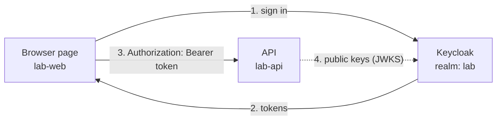

# 01 · Concepts

The words you need before anything else makes sense. Each one points at the
place in this lab where you can see it.

## The big picture

Keycloak is an **identity provider**. Your apps stop handling passwords. They
send people to Keycloak to sign in, and Keycloak sends back **tokens**: signed
statements saying "this is bob, he has these roles, valid for 5 minutes".
Your API checks the signature and believes the statement.

The protocol is **OpenID Connect (OIDC)**, which is **OAuth 2.0** plus a
standard way to say who the user is. OAuth on its own is about *access* ("this
app may call that API"); OIDC adds *identity* ("and the user is bob").



## Realm

A **realm** is a separate world of users, roles, clients and settings. Users in
one realm don't exist in another. This lab uses the realm `lab`.

Every Keycloak also has a realm called **`master`**. It exists to administer
Keycloak itself, and its admins can change every realm. Put your users and apps
in a realm of their own, never in `master`.

## Client

A **client** is an application registered in a realm, identified by a
`clientId`. Two kinds:

| | Public client | Confidential client |
|---|---|---|
| Has a secret? | No | Yes |
| Why | Runs on the user's device (browser, mobile app). Anything shipped there can be read, so a secret would not stay secret. | Runs on a server you control, so it can keep a secret. |
| Proves itself with | PKCE (see [02](02-login-flow.md)) | Its secret |
| In this lab | `lab-web`, the page | `lab-provisioner`, the config script |

The lab also registers **`lab-api`**. Nothing ever signs in as it: all of its
login flows are turned off. It exists so that tokens can name the API as their
audience, and so it can own client roles (exercise 4).

## User

A person, with a username, a password and profile fields. Here: `alice`, `bob`,
`carol`. A client can also get a hidden **service-account user** of its own,
which is how `lab-provisioner` holds roles without being a person.

## Roles: realm roles vs client roles

A **role** is a label like `admin` that you give to users. Your code reads the
label and decides what to allow.

- **Realm roles** belong to the whole realm. They appear in the access token
  under `realm_access.roles`. This lab's `admin`, `manager` and `user` are realm
  roles.
- **Client roles** belong to one client and mean something only to it. They
  appear under `resource_access.<clientId>.roles`. Keycloak's own
  `account` client has roles like `manage-account`, which you can see in every
  token here.

Rule of thumb: use realm roles for job titles that many apps understand, and
client roles for permissions that only one app understands (`lab-api:reports-read`).

**Default roles.** Every realm has a composite role `default-roles-<realm>` that
every new user gets. It bundles `offline_access`, `uma_authorization` and the
`account` client's roles. That is why tokens show more roles than you assigned.
Ignore them in your own checks.

> Lab finding: users created in the admin console or through the REST API get
> `default-roles-lab` automatically, but a **realm import** that lists a user's
> `realmRoles` does not add it. That's why `keycloak/realm-export.json` lists
> `default-roles-lab` for each user explicitly.

The `admin` role in this lab is our own label. It has nothing to do with
administering Keycloak; that power lives in the `realm-management` client roles.

## Scope

A **scope** is a bundle of claims a client asks for at login (`scope=openid
email profile`). `openid` makes it an OIDC login (you get an ID token).
`email` and `profile` add `email`, `name` and similar fields. In Keycloak these
bundles are called **client scopes**, and each holds **protocol mappers**
(rules that put something into the token).

## The three tokens

| Token | Who reads it | What it is for | Lifetime here |
|---|---|---|---|
| **ID token** | The app that logged in | "Who signed in": name, email. Never send it to an API. | 5 min |
| **Access token** | The API | "What the caller may do": roles, audience. Sent as `Authorization: Bearer …` | 5 min |
| **Refresh token** | Keycloak only | Swapped at Keycloak for new access/ID tokens without a new login | until the session idles out (30 min) |

The ID and access tokens are **JWTs** (JSON Web Tokens): `header.payload.signature`,
each part base64url-encoded. Anyone can decode the header and payload; the page
does it for you. The **signature** is what makes a JWT trustworthy, because only
Keycloak's private key can produce one that matches.

Claims worth knowing in an access token:

| Claim | Meaning |
|---|---|
| `iss` | Issuer: which Keycloak realm made it |
| `aud` | Audience: who it is addressed to |
| `azp` | Authorized party: the client that requested it (`lab-web`) |
| `sub` | The user's permanent id. Usernames can change; `sub` doesn't. |
| `exp`, `iat` | Expiry and issued-at, in Unix seconds |
| `realm_access.roles` | Realm roles |
| `resource_access` | Client roles, per client |

## Issuer (`iss`)

The issuer is the realm's public URL: `http://localhost:8180/realms/lab`. It is
written into every token, and the API must expect **exactly** that string.
`http://localhost:8180/realms/lab/` (trailing slash) or
`http://127.0.0.1:8180/realms/lab` count as different issuers. We tested it:
change the API's expected issuer by one slash and every request fails with
`Invalid token: Invalid issuer`.

**Why the API uses two URLs for one Keycloak.** In `docker-compose.yml`:

```yaml
KEYCLOAK_ISSUER:   http://localhost:8180/realms/lab        # what tokens SAY
KEYCLOAK_JWKS_URL: http://keycloak:8080/realms/lab/.../certs  # where the API FETCHES keys
```

The browser reaches Keycloak at `localhost:8180`, so that's the issuer.
Inside the API container, `localhost` means the API container itself, so the
API fetches keys over the Docker network at `keycloak:8080`. The keys are
identical either way. Only the address differs.

**Pin the issuer.** We set `KC_HOSTNAME=http://localhost:8180`. Without it,
`start-dev` builds the issuer from whatever host the request used, so a person
who opened `127.0.0.1:8180` would get tokens the API rejects. With it pinned,
discovery returns the same issuer through every address (tested). Production
always sets a hostname.

## JWKS

**JSON Web Key Set**: Keycloak publishes its *public* signing keys at
`/realms/lab/protocol/openid-connect/certs`. Each token's header has a `kid`
(key id) saying which key signed it. The API downloads the set, picks the
key by `kid`, and verifies the signature, all without calling Keycloak on each
request. When Keycloak rotates keys, a token arrives with an unknown `kid`, and
the API downloads the set again. (We saw this happen: after the realm was
deleted and rebuilt with new keys, the API kept working without a restart.)

## Audience (`aud`)

`aud` says who a token is for. By default a Keycloak access token's audience is
`account` (Keycloak's own account console), because the default roles include
`account` client roles. That's not our API.

We add an **audience mapper** to `lab-web`, so its tokens carry
`"aud": ["lab-api", "account"]`, and the API refuses tokens whose `aud`
doesn't include `lab-api`.

**What it protects against:** a token that is genuine, from your Keycloak,
but meant for a *different* service. Without the check, any app in the realm
could take a token a user gave it and replay it against your API. In this lab
we tried it: the `lab-provisioner` service account's token is perfectly signed
by the same Keycloak, but its `aud` is `["realm-management", "account"]`, so
the API answers `401 Invalid token: Audience doesn't match`.

## 401 vs 403

- **401 Unauthorized**: "I can't tell who you are." Missing, forged, expired,
  wrong issuer or wrong audience.
- **403 Forbidden**: "I know exactly who you are, and you may not do this."
  Valid token, missing role.
