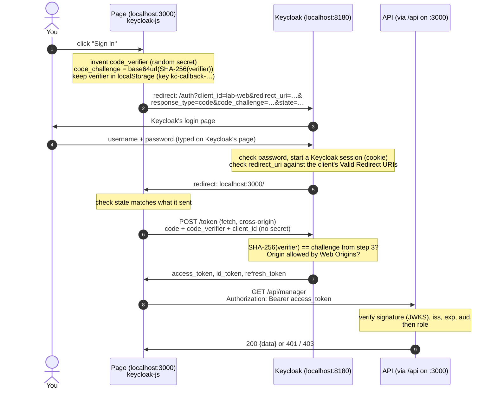

# 02 · The login flow, step by step

What happens between clicking **Sign in** and the API answering. The flow is
called **Authorization Code + PKCE**. `keycloak-js` does all of it in
`web/app.js`; `scripts/login_flow_demo.py` does it by hand and prints every
step, so it isn't magic:

```bash
python3 scripts/login_flow_demo.py bob bob-dev
```

## The sequence



## The steps in words

1. **Click Sign in.** `keycloak.login()` makes a random **code verifier** and
   keeps it in `localStorage` under `kc-callback-<state>` until the user comes
   back. It hashes it into a **code challenge**.
2. **Redirect to Keycloak.** The whole tab navigates to Keycloak's
   *authorization endpoint* with `client_id`, `redirect_uri`, the challenge, and
   a random `state`.
3. **Log in on Keycloak's page.** The password goes to Keycloak and nowhere
   else. Keycloak starts its own session (cookies on `localhost:8180`). That
   session is what makes "sign in once, every app knows you" (single sign-on)
   work.
4. **Redirect back with a code.** Keycloak sends the browser to the
   `redirect_uri` with a short-lived, one-time **authorization code**. It
   refuses any `redirect_uri` that isn't on the client's list, so an attacker
   can't have codes sent to their own site.
5. **Exchange the code.** The page `POST`s the code *and the original verifier*
   to Keycloak's *token endpoint*. Keycloak hashes the verifier and compares it
   with the challenge from step 2. Someone who stole the code from the URL
   doesn't have the verifier, so the stolen code is useless. This is how a
   public client (no secret) is kept safe.
6. **Tokens arrive.** Access, ID and refresh tokens. `keycloak-js` keeps them in
   memory and refreshes the access token with the refresh token before it
   expires (`updateToken(30)` in `app.js`).
7. **Call the API.** Every request carries `Authorization: Bearer <access
   token>`. The API checks signature, issuer, expiry, audience, then role.

On page reload, `onLoad: 'check-sso'` repeats steps 2–6 in a hidden iframe
(`silent-check-sso.html`). Keycloak's session cookie is still there, so there's
no login form: you come back signed in without seeing a redirect.

**Sign out** calls Keycloak's *end-session endpoint*, which ends the Keycloak
session (not only the page's tokens) and redirects to a URL allowed by the
client's `post.logout.redirect.uris`.

## Why the app must never collect passwords

The OAuth "password grant" (`grant_type=password`, called **Direct Access
Grants** in Keycloak) lets an app take the username and password itself and
trade them for tokens. It is turned **off** on `lab-web`, because:

- Every app that sees passwords is one more place they can leak from.
- Users learn to type their password into any page that asks, which is exactly
  what phishing relies on.
- Keycloak's own features stop working: two-factor login, "forgot password",
  required actions, social login, brute-force protection. All of them live on
  Keycloak's login page.
- It is removed from the OAuth 2.1 draft.

The only password-grant call in this lab is the one-time master-admin
bootstrap in `configure.py` (see [03](03-config-as-code.md)), using Keycloak's
built-in `admin-cli` client the way `kcadm.sh` does.

## Traps on this path

**Redirect URIs.** `lab-web` allows `http://localhost:3000/*`. Open the page as
`http://127.0.0.1:3000` and Keycloak shows *"Invalid parameter: redirect_uri"*,
because to Keycloak that is a different site. Never use `*` alone in production:
it lets any site receive your users' codes.

**Web Origins.** Step 5 is a `fetch` from `localhost:3000` to `localhost:8180`,
a different origin, so the browser enforces CORS. Keycloak only sends the
`Access-Control-Allow-Origin` header for origins listed in the client's Web
Origins (`http://localhost:3000`). Leave it out and login seems to work, but the
token request fails with a CORS error in the console. (`+` means "every origin
of my redirect URIs".) Each token also lists them in `allowed-origins`.

**Secure cookies on plain HTTP.** Keycloak marks its login cookies `Secure`
even here. Chrome and Firefox send them to `http://localhost` because they treat
localhost as a secure context; tools like httpx don't, which is why
`login_flow_demo.py` forwards them by hand. When they go missing, Keycloak
logs `LOGIN_ERROR ... error="cookie_not_found"`. Behind a real domain, use
HTTPS. The lab was tested in Chrome; Safari's handling of localhost is less
predictable, so use Chrome or Firefox here.

**The iss/JWKS split.** See [01, Issuer](01-concepts.md#issuer-iss).
